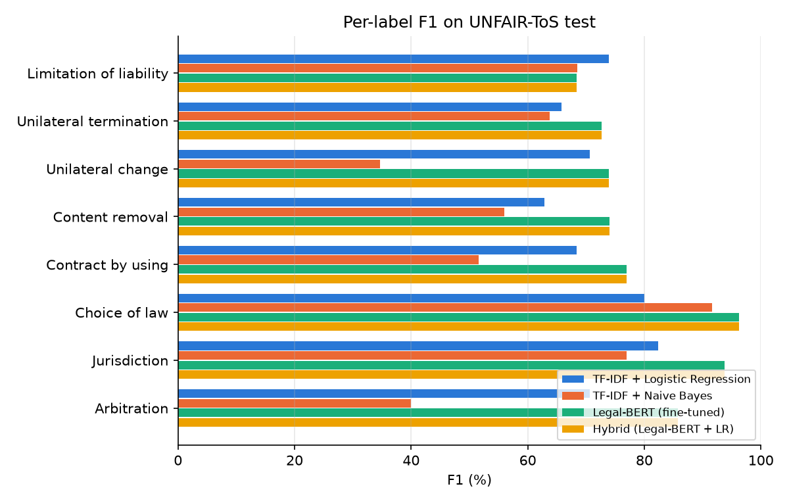
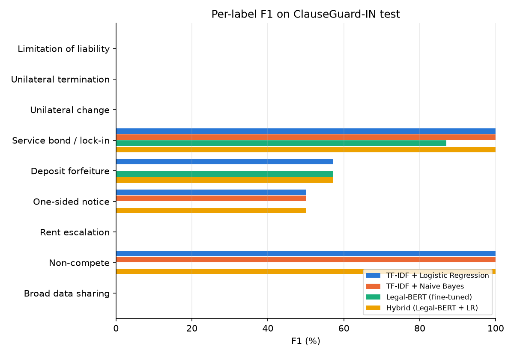
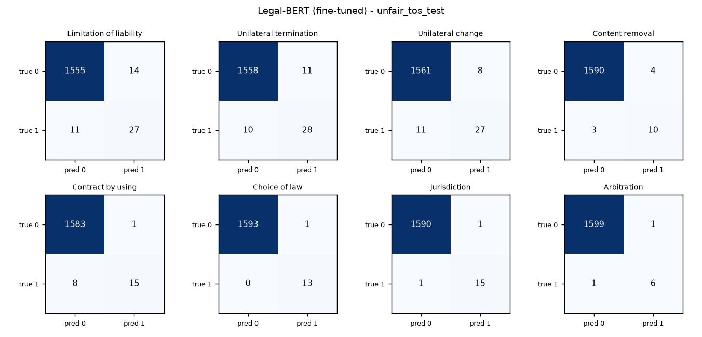
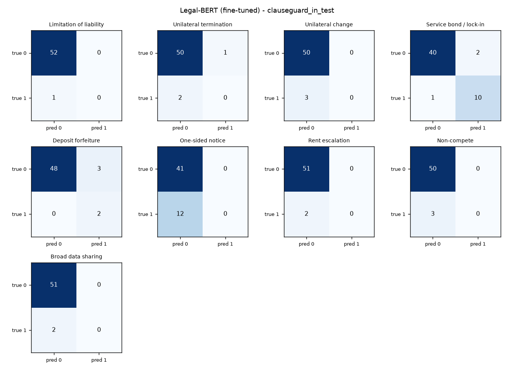

# Results

_Generated by `training/evaluate.py` on 2026-10-12T16:14:22+00:00. All numbers are computed from the saved models; nothing is hand-written._

## UNFAIR-ToS test set (8 labels)

| Model | Micro P | Micro R | Micro F1 | Macro P | Macro R | Macro F1 |
|---|---|---|---|---|---|---|
| TF-IDF + Logistic Regression | 72.0 | 70.4 | 71.2 | 71.3 | 75.5 | 71.8 |
| TF-IDF + Naive Bayes | 75.8 | 50.5 | 60.7 | 79.0 | 51.5 | 60.4 |
| Legal-BERT (fine-tuned) | 77.5 | 75.8 | 76.6 | 81.5 | 79.7 | 80.2 |
| Hybrid (Legal-BERT + LR) | 77.5 | 75.8 | 76.6 | 81.5 | 79.7 | 80.2 |

Per-label F1 (%):

| Label | Support | TF-IDF + Logistic Regression | TF-IDF + Naive Bayes | Legal-BERT (fine-tuned) | Hybrid (Legal-BERT + LR) |
|---|---|---|---|---|---|
| Limitation of liability | 38 | 74.0 | 68.5 | 68.3 | 68.3 |
| Unilateral termination | 38 | 65.8 | 63.8 | 72.7 | 72.7 |
| Unilateral change | 38 | 70.6 | 34.6 | 74.0 | 74.0 |
| Content removal | 13 | 62.9 | 56.0 | 74.1 | 74.1 |
| Contract by using | 23 | 68.4 | 51.6 | 76.9 | 76.9 |
| Choice of law | 13 | 80.0 | 91.7 | 96.3 | 96.3 |
| Jurisdiction | 16 | 82.3 | 76.9 | 93.8 | 93.8 |
| Arbitration | 7 | 70.6 | 40.0 | 85.7 | 85.7 |

## ClauseGuard-IN test set (14 labels)

| Model | Micro P | Micro R | Micro F1 | Macro P | Macro R | Macro F1 |
|---|---|---|---|---|---|---|
| TF-IDF + Logistic Regression | 83.3 | 52.6 | 64.5 | 37.8 | 37.0 | 34.1 |
| TF-IDF + Naive Bayes | 90.0 | 47.4 | 62.1 | 33.3 | 25.9 | 27.8 |
| Legal-BERT (fine-tuned) | 66.7 | 31.6 | 42.9 | 13.7 | 21.2 | 16.0 |
| Hybrid (Legal-BERT + LR) | 83.3 | 52.6 | 64.5 | 37.8 | 37.0 | 34.1 |

Per-label F1 (%):

| Label | Support | TF-IDF + Logistic Regression | TF-IDF + Naive Bayes | Legal-BERT (fine-tuned) | Hybrid (Legal-BERT + LR) |
|---|---|---|---|---|---|
| Limitation of liability | 1 | 0.0 | 0.0 | 0.0 | 0.0 |
| Unilateral termination | 2 | 0.0 | 0.0 | 0.0 | 0.0 |
| Unilateral change | 3 | 0.0 | 0.0 | 0.0 | 0.0 |
| Service bond / lock-in | 11 | 100.0 | 100.0 | 87.0 | 100.0 |
| Deposit forfeiture | 2 | 57.1 | 0.0 | 57.1 | 57.1 |
| One-sided notice | 12 | 50.0 | 50.0 | 0.0 | 50.0 |
| Rent escalation | 2 | 0.0 | 0.0 | 0.0 | 0.0 |
| Non-compete | 3 | 100.0 | 100.0 | 0.0 | 100.0 |
| Broad data sharing | 2 | 0.0 | 0.0 | 0.0 | 0.0 |

## Figures

Confusion matrices are shown for the model with the best UNFAIR-ToS macro-F1 (Legal-BERT (fine-tuned)).

## Notes

- Macro averages use only labels that appear in that test set.
- ClauseGuard-IN test clauses come from templates never seen in training (group split), but the set is small (about 50 clauses), so its scores have high variance.
- Hybrid uses Legal-BERT for the 8 UNFAIR-ToS labels and the LR baseline for the 6 India-specific labels.
- Predictions use the per-label thresholds tuned on the dev set and the same document-type filter as the app.
